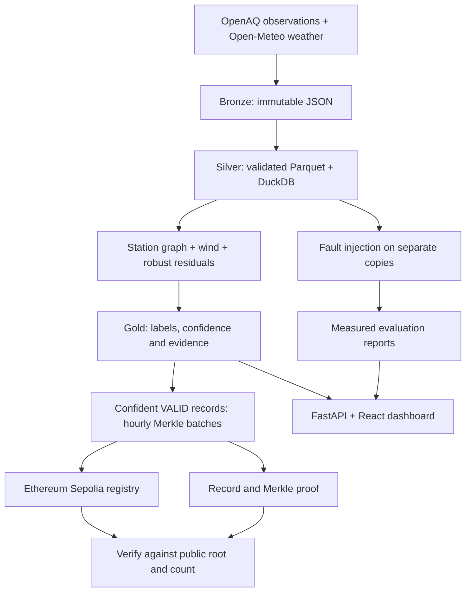
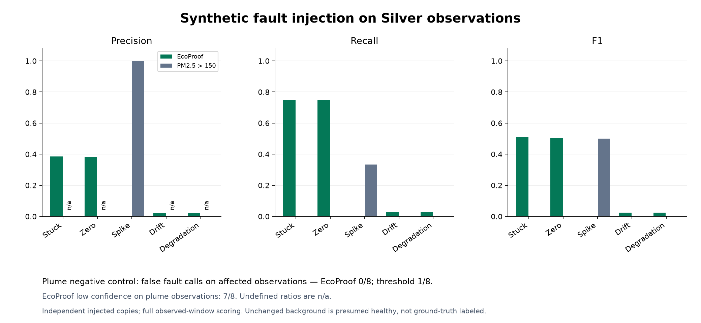

# EcoProof

**Inspect air-quality data. Verify what was recorded.**

EcoProof is a full-stack environmental monitoring prototype that combines
explainable sensor-quality checks with independently verifiable records.
It processes real OpenAQ observations and Open-Meteo weather, shows the evidence
behind suspected faults and pollution plumes, and commits eligible hourly
batches to Ethereum Sepolia.

**Python · FastAPI · DuckDB · Parquet · Solidity · web3.py · React · TypeScript · Leaflet**

[Public transaction](https://sepolia.etherscan.io/tx/0xbc325583e39e7778538a69878d9507281444a2e508ce13f048df455096ca5e49)
· [Engineering case study](docs/PORTFOLIO.md)
· [Run locally](#setup)
· [Evaluation](#measured-results)
· [Demo walkthrough](docs/DEMO.md)


*Actual local application: Delhi station map, observed/expected PM2.5 charts,
wind context and saved event evidence. Observations are historical, with gaps
preserved; the map includes catalog locations without current readings.*

## The problem

A suspicious reading can come from a failing sensor or a real local pollution
source. Monitoring teams need the surrounding evidence to judge that reading.
Auditors also need to establish whether the record they received matches what
was originally committed.

EcoProof connects those workflows. A geographic station graph, wind weighting
and temporal checks produce a quality assessment with explicit uncertainty.
Merkle proofs then let a reviewer check a record against a public commitment.
The commitment proves record integrity; it cannot prove that a sensor was right.

## What works

| Capability | Demonstrated behavior |
| --- | --- |
| Data pipeline | Immutable raw API snapshots, validated/deduplicated Parquet, UTC alignment and rebuildable DuckDB views |
| Quality assessment | Neighbor and wind context, robust residual scores, suspected-fault/plume evidence and low-confidence handling |
| Audit workflow | Canonical record bytes, hourly Merkle snapshots, a write-once Solidity registry and independent proof verification |
| Application | Station map, observed/expected charts, nearby comparisons, event inspection, editable verification and evaluation views |

The recorded Delhi run contains **7,596 PM2.5 observations from 12 locations**,
240 weather hours and 1,546 hourly classifications. Ten locations have observations
across the seven-day output window, with sampling gaps. The catalog contains 94
locations; that is not the number of active sensors in this run.

## A public proof you can check

One **seven-record batch** is anchored on Ethereum Sepolia. In the demonstrated
CLI and browser flow, the saved value **22.0000 passes**, changing it to
**23.0000 fails**, and restoring it passes again.

| Public evidence | Link |
| --- | --- |
| Registry | [`0xb120d4671607E7C24F6C14C4f23B589F5f4484EB`](https://sepolia.etherscan.io/address/0xb120d4671607E7C24F6C14C4f23B589F5f4484EB) |
| Anchor transaction | [Successful Sepolia transaction](https://sepolia.etherscan.io/tx/0xbc325583e39e7778538a69878d9507281444a2e508ce13f048df455096ca5e49) |
| Portable sample | [Canonical record and Merkle path](reports/sepolia-proof.json) |
| Recorded checks | [Receipt/readback](reports/sepolia-demo.json) · [Browser results](reports/demo-browser.json) · [Check without a database](reports/handoff-check.json) |
| Screenshots | [Original passes](reports/demo-verify.png) · [Edited record fails](reports/demo-tampered.png) |

After installing the Python dependencies and compiling the contract as shown
below, set a Sepolia `RPC_URL` in your local `.env` and run:

```text
uv run --locked python scripts/verify_public_demo.py
uv run --locked python scripts/verify_public_demo.py --tamper
```

The first check should exit **0** with `verified: true`; the in-memory edit
should exit **1** with `verified: false`. Exit **2** means the check could not
run. The checker pins the published contract and batch, reads the current root
and count, and needs **no local database, signing key or new transaction**.
It trusts the configured RPC's chain response. [Verification details](docs/ANCHORING.md).

## Engineering decisions

- **Reproducible data, explicit publication.** Bronze responses are immutable.
  Silver/Gold builds publish completed Parquet snapshots through transactional
  DuckDB view changes. Invalid rows retain rejection reasons, and missing hours
  remain missing. [Pipeline implementation](src/ecoproof/transform/).
- **Uncertainty is part of the result.** Insufficient neighbors, missing context
  and ambiguous transport remain low confidence. Those rows do not enter the
  confident-VALID batches. [Classifier](src/ecoproof/detect/classifier.py).
- **Deterministic bytes across the stack.** Sorted JSON keys, UTC timestamps,
  four-decimal rounding, domain-separated SHA-256 nodes and documented odd-leaf
  handling make record proofs reproducible. [Merkle format](docs/MERKLE.md).
- **Recoverable blockchain writes.** Signed transaction intent is persisted
  before broadcast. Retries reuse that intent; successful receipts, events and
  registry readback precede marking a batch mined. [Chain client](src/ecoproof/provenance/anchor.py).
- **Measured debugging.** Archived failures, fixed input fingerprints and paired
  experiments document why detector rules changed. The flatline correction
  improved stuck/zero F1 on the development cases and a separate week, while
  preserving weak results for other fault types. [Case study](docs/PORTFOLIO.md).

## Layout and intended architecture



The API serves six core routes: `/stations`, `/readings`, `/events`, `/batches`,
`/proof` and `/verify`. The frontend keeps backend credentials out of browser
configuration. [API contract](docs/API.md) · [Frontend design](web/README.md).

## Measured results

Real observations have no independently confirmed fault labels. Evaluation
therefore injects known faults into **separate copies of real data**, with a
fixed `PM2.5 > 150` threshold as the comparison. These are experimental scores,
not field accuracy or a deployment performance claim.

The current development report contains 18 cases, three per intervention type:

| Fault type | EcoProof F1 | Threshold F1 |
| --- | ---: | ---: |
| Stuck | 0.509 | 0.000 |
| Zero | 0.505 | 0.000 |
| Spike | 0.000 | 0.500 |
| Gradual drift | 0.025 | 0.000 |
| Degradation | 0.024 | 0.000 |

The plume negative control has **0 false faults among 8 affected observations**,
with **7 still low confidence**. Passing that control does not establish complete
plume recognition. Separate-period controls retained 0/14 and 0/15 false faults.



[Full precision/recall and confusion counts](reports/eval.json)
· [Evaluation protocol](docs/EVALUATION.md)
· [Flatline correction](docs/DETECTOR_REVIEW.md)
· [Plume ambiguity review](docs/PLUME_REVIEW.md)

## Setup

Use **Python 3.11**, [uv](https://docs.astral.sh/uv/) and **Node 22.13+**.
Chrome is required for the default browser tests; [other browser choices](web/README.md#tests-and-browser-prerequisites)
are documented. GNU Make is installed by the development dependencies on
Windows; install it separately on macOS/Linux, or use the direct Python commands.

```text
git clone https://github.com/ks-exe/EcoProof_Climate-Data-Environmental-Monitoring.git
cd EcoProof_Climate-Data-Environmental-Monitoring
uv sync --locked
npm --prefix contracts ci
npm --prefix contracts run compile
npm --prefix web ci
npm --prefix web run build
```

In PowerShell, use `npm.cmd` if execution policy blocks `npm.ps1`. Copy
`.env.example` to `.env` only if `.env` does not already exist, then configure
the operation you want to run:

| Setting | Needed for |
| --- | --- |
| `OPENAQ_API_KEY` | Fetching OpenAQ observations; get a key from [OpenAQ](https://explore.openaq.org/register) |
| `RPC_URL` | Reading Ethereum Sepolia for public proof verification |
| `REGISTRY_ADDRESS` | API verification against an existing registry; use the published address above |
| `PRIVATE_KEY` | Deploying or submitting new batches only; use a funded throwaway testnet wallet |
| `ECOPROOF_DATA_DIR` | Optional data directory; defaults to `data/` |

**A clone contains code, reports and the portable proof, but no credentials or
observations database.** The saved proof can be checked without rebuilding the
dataset. To populate Monitor, run the real-data ingestion, classification and
batch preparation commands in [the demo guide](docs/DEMO.md#reproduce-the-data-run).
Fresh provider responses may differ from the published snapshot.

After preparing data, start these in separate terminals at the repository root:

```text
uv run --locked make api
uv run --locked make web
```

Open **http://127.0.0.1:5173** for the dashboard and
**http://127.0.0.1:8000/docs** for the API. These are local addresses, not a hosted
public deployment. Before ingestion/building, data routes return an explicit
unavailable-data response. Stop API readers before running database writers.

For a Make-free start, use `uv run --locked python -m uvicorn
ecoproof.api.main:app --host 127.0.0.1 --port 8000` and `npm --prefix web run dev`
in separate terminals. [Detailed development reference](docs/DEVELOPMENT.md).

## Tests

After setup:

```text
uv run --locked pytest -q
npm --prefix contracts test
npm --prefix web test
npm --prefix web run build
```

The recorded full suite passed **447 tests**, including an isolated local EVM
and browser acceptance. All **14 frontend unit tests** and the production build
also passed. [Execution history and warnings](docs/PROGRESS.md) distinguish
software tests, real-data experiments and public Sepolia checks. The executed
commands and their output are retained for review.

Tests cover malformed inputs, missing observations, classifier ambiguity,
Merkle edge cases, tampering, duplicate anchoring, API errors and the browser
workflow. Offline tests need no service credentials. Missing required browser
or contract tooling fails explicitly.

## Repository guide

| Path | Purpose |
| --- | --- |
| [`src/ecoproof/`](src/ecoproof/) | Ingestion, transforms, graph, detector, provenance and FastAPI |
| [`contracts/`](contracts/) | Solidity registry, locked compiler, tests and deploy entry point |
| [`web/`](web/) | React/TypeScript application and browser tests |
| [`tests/`](tests/) | Python unit and integration tests |
| [`reports/`](reports/) | Measured evaluation, screenshots, public proof and preserved experiments |
| [`scripts/`](scripts/) | Independent proof checker and reproducible detector reviews |
| [`docs/`](docs/) | Design contracts, development guide, demo, case study and video script |

## Scope and next steps

The prototype uses one region, cached historical observations and regional
weather. It does not simulate atmospheric dispersion or directly measure
carbon emissions. Spike, drift and degradation detection remain weak; the
plume safeguard often retains uncertainty. Public anchoring covers one of 165
prepared batches. A future pilot needs independent fault labels, stronger
validation and feedback from monitoring users. Throughput, operating cost and
operational impact at scale have not been measured.

Built for the **IEEE ClimateChain Global Hackathon**, **Climate Data &
Environmental Monitoring** track. [Submission description](docs/SUBMISSION.md)
· [Demo recording script](docs/VIDEO_SCRIPT.md).

## License and attribution

Software is licensed under [MIT](LICENSE). OpenAQ observations, Open-Meteo
weather and OpenStreetMap tiles retain their respective provider terms and
attribution. The software license does not relicense source data.

Maintainer: [ks-exe](https://github.com/ks-exe).
Development follows [AGENTS.md](AGENTS.md) and the unchanged
[implementation spec](docs/SPEC.md).
