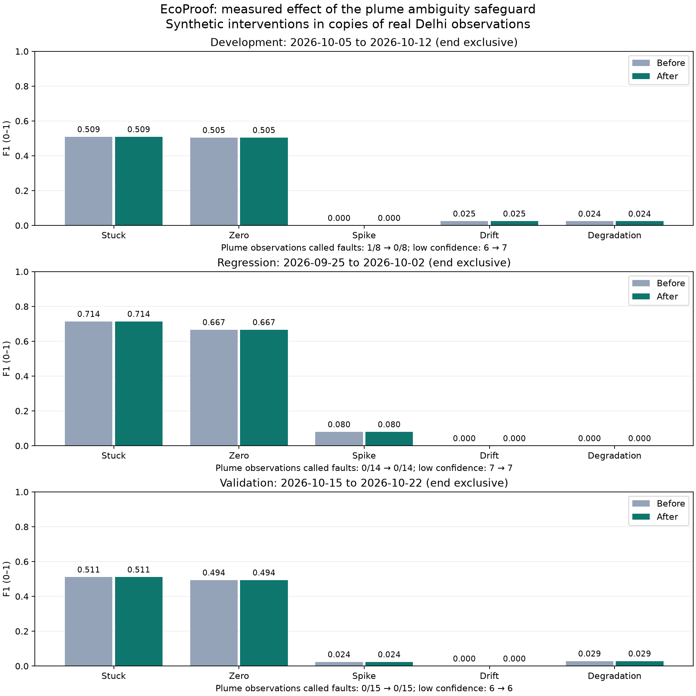

# Plume ambiguity review — October 24, 2026

This task addresses an isolated-fault decision made despite a recent upwind
anomaly. It preserves the strict plume confirmation rule and all numerical
thresholds. The pre-change classifier, report and chart are retained in
`reports/history/2026-10-24-pre-plume/`; classifier SHA-256:
`450ed3dcc326c89d4d9b6406c374d3ab433fc8ffa7dd2c47d6ea978b8e809af1`.

## Development diagnosis

In development case `plume-18`, station 6957 at October 5 06:00 UTC has an
injected source value 125.5, positive residual 96.8923 and z 9.5585. The receiver,
6254665 at 07:00 UTC, rises from 34.5675 at source time to 80.515. A falling
background leaves its older six-hour reference high enough that the strict
lagged-rise test fails. The source is low-confidence `neighbors_also_changed`,
while the receiver is called `suspected_isolated_anomaly`.

The issue is uncertainty handling: an unconfirmed source is not proof of a
plume, but it can contradict an isolated-fault claim at a nearby later spike.

## Rule fixed before separate-period scoring

- Keep strict `VERIFIED_PLUME_EVENT` logic and supported-source protection.
- Only reconsider an otherwise `suspected_isolated_anomaly` with positive
  residual and z at/above the existing threshold. Flat/zero and persistent-drift
  decisions are outside this new fallback.
- Require a source observation one to three actual hours earlier, with a
  positive residual, threshold-crossing z, at least two neighbors, valid wind,
  and a rise above its own recent reference by the existing threshold/scale.
  The first-pass source must be a confirmed plume or uncertain because neighbors
  changed/evidence was incomplete; a suspected-fault source cannot clear another
  suspected fault. Newly reconsidered arrivals cannot recursively become sources.
- Require source-time wind toward the receiver, distance inside the graph,
  and lag consistent with distance/wind speed using the unchanged tolerance.
- Require an observed receiver reading at source time and a later positive step
  at least `z_threshold * receiver.baseline_sigma`. This reuses the existing
  calibrated residual scale to bound the step; it is a heuristic, not a new
  estimate of atmospheric transport or a fitted temporal-noise model.
- Retain the receiver as low-confidence `VALID`, reason
  `possible_upwind_transport`, with the actual source station/time links.
  Do not upgrade either observation to a confirmed plume through this fallback.

## Evaluation protocol fixed before the new experiment

- Development: October 5–11 output, October 3–4 calibration, existing three
  cases per type and seed 42. Preserve and compare every original intervention.
- Previously inspected regression period: September 25–October 1 output,
  September 23–24 calibration, five cases per type, seed 2026. This is a
  regression comparison, not a newly unseen validation set.
- New temporal validation: October 15–21 output, October 13–14 calibration,
  October 22 follow-up; five cases per type, seed 20261024. Select the same Delhi
  region, 25 km catalog radius and first 12 eligible locations by the existing
  availability/geometry rules. No selection by detector performance.
- Ingest immutable observations and build a separate Silver database. Check
  coverage without scoring the new period until the rule and synthetic tests
  are frozen. Do not change the rule after inspecting its new-period scores in
  this task. Report unavailable coverage or failed controls rather than selecting
  a better-scoring period.
- Sigma 10 km, alpha 0.5, tau 20 km, z threshold 2.5, scale floor 1 and all other
  detector/injection settings remain unchanged. Compare before/after on matching
  inputs and interventions, scoring every output row including low-confidence
  misses and presumed-healthy background.
- Publish all fault types, plume false faults, source labels and confidence
  counts. Preserve any recall loss or newly failed control. A passing plume
  control is not evidence of adequate overall detection or field accuracy.

The ten new synthetic regression cases reproduced two failures before the fix;
the focused classifier/evaluation suite then passed all 75 tests. The corrected
classifier was frozen before scoring the new period, SHA-256
`b4dbcd390245fb3147217e8237c0633a2407c484a648b37bd76a804d2eaf0982`.
`scripts/review_plume.py` checks both revision hashes before running.

The offline driver memoizes pure wind-weight matrices across intervention copies
using every coordinate and graph/wind option as the cache key. Cached matrices
are immutable; readings and predictions are never cached. Three distinct
synthetic cases, including reversed cache reuse, produced exactly the same full
classifications with and without this optimization. This does not change the
classifier source hash, thresholds, evaluation inputs, or intervention plan.

## Measured results

Every pair passed input-fingerprint, configuration, coverage and intervention
equality checks. The earlier development and regression measurements were reused
only after checking their frozen classifier hash and current input fingerprint;
their reports record `measurement_reused_from`. Both new-period versions and all
three corrected-period evaluations were executed in this task.

| Period | Cases per type | Plume false faults, before → after | Low confidence on plume, before → after | Background flags, before → after |
| --- | ---: | --- | --- | --- |
| Development, October 5–11 | 3 | 1/8 → 0/8 | 6/8 → 7/8 | 15 → 15 |
| Previously inspected, September 25–October 1 | 5 | 0/14 → 0/14 | 7/14 → 7/14 | 4 → 4 |
| New validation, October 15–21 | 5 | 0/15 → 0/15 | 6/15 → 6/15 | 16 → 16 |

The development source labels remain one `VERIFIED_PLUME_EVENT` and two `VALID`;
the correction does not create additional confirmed sources. The regression
period has five plume-labeled sources. New validation has four plume-labeled
sources and one `VALID` source, unchanged between versions. A passed control
means no false fault on these affected observations, not complete recognition.

All fault-type confusion counts, metrics and unchanged-data confidence counts
are identical before and after this correction in all three periods. F1 remains:

| Fault | Development | Regression | New validation |
| --- | ---: | ---: | ---: |
| Stuck | 0.509434 | 0.714286 | 0.511111 |
| Zero | 0.504673 | 0.666667 | 0.494118 |
| Spike | 0.000000 | 0.080000 | 0.024096 |
| Drift | 0.025000 | 0.000000 | 0.000000 |
| Degradation | 0.024390 | 0.000000 | 0.028777 |



The new pull returned 8,065 PM2.5 observations from 12 locations and 240 weather
hours, stored in 20 new immutable Bronze files. The separate unbounded Silver
build contains all three periods: 23,158 readings, 94 catalog stations and 720
weather hours, with zero rejected rows. The exact 85 source snapshots/hashes are
in [the input manifest](../reports/plume-review/bronze-manifest.json).
The new evaluation reads 7,376 raw rows and 219 weather hours within its
calibration/output/follow-up bounds, and scores 1,787 rows per copy at 12
locations; 11 have observations on all seven output dates. Gaps remain.

New-period input fingerprint:
`b163a9f87a5ed1870f719f1d70e536611cf3921a89749e0ac74bf6d620af06e2`.
The classifier was not changed after scoring this period. Its two commands exited
0. Development-before exits 1 for the archived failure; all other commands exit
0. [Complete comparison counts](../reports/plume-review/comparison.json) and the
six `eval.json` reports under `reports/plume-review/` preserve all results.

## Reproduce

Use the normal project environment, existing development/regression inputs from
the flatline review, and this additional real-data pull:

```text
uv run --locked python -m ecoproof.ingest --source all --region delhi --latitude 28.6139 --longitude 77.2090 --radius-m 25000 --start-date 2026-10-13 --end-date 2026-10-22 --station-limit 12
```

Prepare the isolated Silver snapshot with this Python snippet. The original
build was slow; reuse the completed snapshot for repeated evaluations.

```python
from pathlib import Path
import shutil
from ecoproof.config import Settings
from ecoproof.transform.silver import build_silver

root = Path('.cache/plume-review-data').resolve()
(root / 'bronze').mkdir(parents=True, exist_ok=True)
for source in Path('data/bronze').glob('*.json'):
    target = root / 'bronze' / source.name
    if target.exists():
        assert target.read_bytes() == source.read_bytes()
    else:
        shutil.copy2(source, target)
build_silver(Settings(data_dir=root), region_id='delhi')
```

Run these separately so the expected development-before exit 1 does not stop
the rest of the comparison:

```text
uv run --locked python scripts/review_plume.py --data-dir data --period development --revision before
uv run --locked python scripts/review_plume.py --data-dir data --period development --revision after
uv run --locked python scripts/review_plume.py --data-dir .cache/detector-review-data --period regression --revision before
uv run --locked python scripts/review_plume.py --data-dir .cache/detector-review-data --period regression --revision after
uv run --locked python scripts/review_plume.py --data-dir .cache/plume-review-data --period validation --revision before
uv run --locked python scripts/review_plume.py --data-dir .cache/plume-review-data --period validation --revision after
uv run --locked python scripts/plot_plume_review.py
```

The before-report reuse deliberately refuses different observations or settings.
Fresh provider revisions may require a new paired experiment; do not mix their
after scores with these archived before measurements.

## Application and limits

The corrected development report and chart are served on the dashboard. All
1,546 actual app records retain identical canonical hashes, including the seven
publicly anchored records: [snapshot check](../reports/plume-review/current-snapshot-check.json).
No live Silver/Gold rebuild or additional chain transaction was necessary.
Actual Chrome verification still accepts the original, rejects its edited value
and accepts the restored record. The new comparison figure and dashboard
evaluation screenshot were visually inspected.

This resolves the measured development false fault through uncertainty handling.
It does not improve the weak spike/drift/degradation scores or establish field
accuracy. With the submission deadline approaching, broader detector research
belongs after this prototype submission; preserve these limitations in the video.
