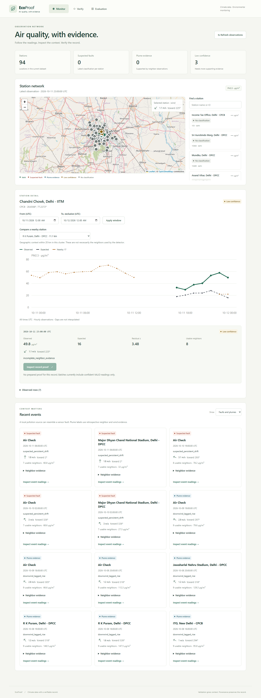
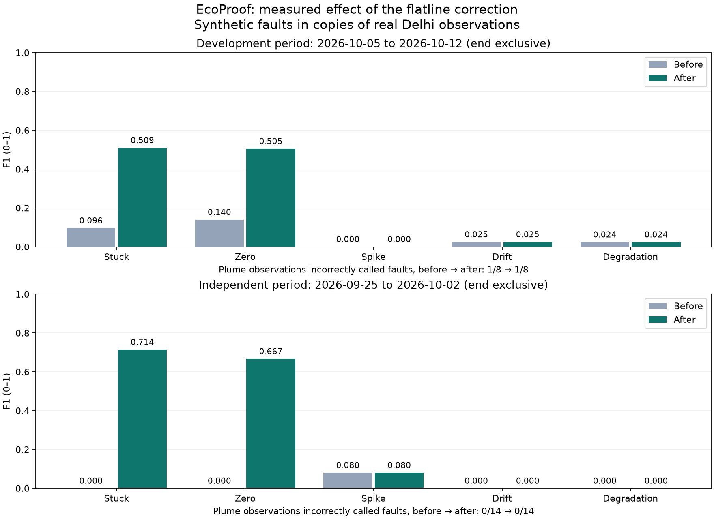

# EcoProof — project case study

EcoProof is a full-stack environmental monitoring prototype that connects
air-quality data validation with record provenance. Its workflow runs from
cached provider responses to a map, evidence-backed classifications, and
individually inspectable Merkle proofs.

## Problem and design

A suspicious PM2.5 reading may come from a faulty sensor or a local pollution
source. A blockchain commitment can show that a record has not changed since
it was anchored; it cannot decide which explanation is correct.

EcoProof therefore keeps the quality assessment separate from the provenance
claim. A station graph and regional wind support an explainable, retrospective
detector. An auditor can inspect the observed and expected values, uncertainty,
and saved evidence before examining the record's canonical bytes and proof.
Only confident VALID records enter the validated-data batches.

## Engineering work to demonstrate

- **Data pipeline:** immutable OpenAQ/Open-Meteo snapshots, validation and
  deduplication, UTC interval handling, rebuildable Parquet, and transactional
  DuckDB view publication. Missing measurements remain gaps.
- **Detection and evaluation:** geographic weights, meteorological wind
  conversion, robust baseline scales, confidence safeguards, and controlled
  fault injection on copies of real observations. The
  [reliability review](DETECTOR_REVIEW.md) preserves a failed first experiment,
  a concrete rule correction, and paired before/after results.
- **Provenance:** deterministic canonical JSON, domain-separated SHA-256 trees,
  odd/single-leaf proofs, tampering checks, and an owner-only, write-once Solidity
  registry. A seven-record batch is anchored and verified on public Sepolia,
  with original-pass/edit-fail checks in the CLI and browser.
- **Application:** typed FastAPI responses, React/Leaflet station exploration,
  evidence and uncertainty displays, editable proof verification, measured
  evaluation charts, and browser checks on desktop and mobile.

## A concrete debugging example

The first implementation identified a supported flatline, then rejected that
evidence when neighboring pollution changed. That contradicted the purpose of
comparing a flat sensor with varying peers. The correction treats the temporal
signal independently, requires two complete supporting neighbors, and keeps
sparse-data safeguards. Regression tests cover changing pollution, missing
hours, insufficient peer support, and regional zero readings.

On the unchanged development cases, stuck/zero recall increased to 27 of 36
injected observations for each type. The whole-window F1 values increased from
0.096/0.140 to 0.509/0.505. Those figures include background flags and missed
faults. They are synthetic-intervention results, not an estimate of field
accuracy. With rules frozen before scoring a separate week, stuck/zero F1 also
increased from 0/0 to 0.714/0.667 over five cases per type, while unchanged-data
fault flags remained four. The [full comparison](DETECTOR_REVIEW.md) includes
unchanged weak fault types and the development plume failure in that revision.

The next debugging task found that falling background pollution could hide a
later rebound from the plume rule's older reference. A recent upwind anomaly now
prevents an unsupported isolated-fault claim when the geometry, timing and
observed positive step agree. The row remains explicitly uncertain. The same
development control improved from 1/8 to 0/8 false faults, with 7/8 affected rows
low confidence and unchanged fault-type scores. The
[plume ambiguity review](PLUME_REVIEW.md) preserves the original failure,
regression tests and separate-period comparison.
The newly scored week also retained zero false faults on 15 affected plume
observations, with six uncertain and no changes to its fault-type scores.

## Current limits and next milestone

The prototype uses one city and regional weather. It does not establish true
fault labels, simulate atmospheric dispersion, or measure carbon emissions.
The development plume control now passes, with most affected observations still
uncertain. Spike, drift and degradation detection remain weak. The test suite's
447 passes establish software behavior, not real-world model quality. The
[handoff](HANDOFF.md) includes clean-export setup checks and an independent
public-proof verifier that needs no operator database or signing key.

The public testnet demonstration is complete:
[the seven-record anchor](https://sepolia.etherscan.io/tx/0xbc325583e39e7778538a69878d9507281444a2e508ce13f048df455096ca5e49)
accepts the original record and rejects an edited value. This protects integrity
without resolving the detector's remaining quality limitations. Improving and
validating those rules is the next engineering milestone. The
[public repository](https://github.com/ks-exe/EcoProof_Climate-Data-Environmental-Monitoring)
contains the code and measured evidence. The narrated demo video remains an
owner action.

## Portfolio description

> Built EcoProof, a Python/FastAPI and React platform that processes real
> air-quality observations into explainable quality assessments and Merkle
> proofs. Implemented immutable data ingestion, reproducible fault-injection
> evaluation, a Solidity batch registry, and a tested audit dashboard.

Add the actual demo video alongside the public repository and verified testnet
transaction in this case study. Use the measured results and stated
limitations when discussing the project.
